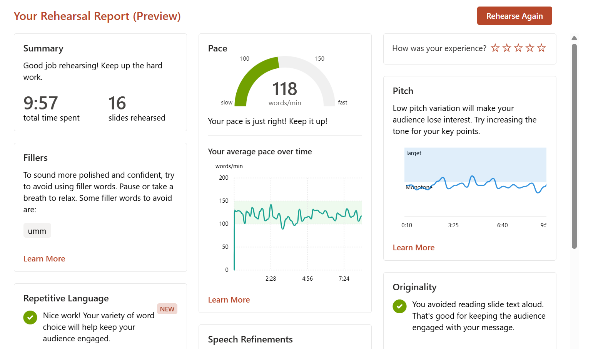
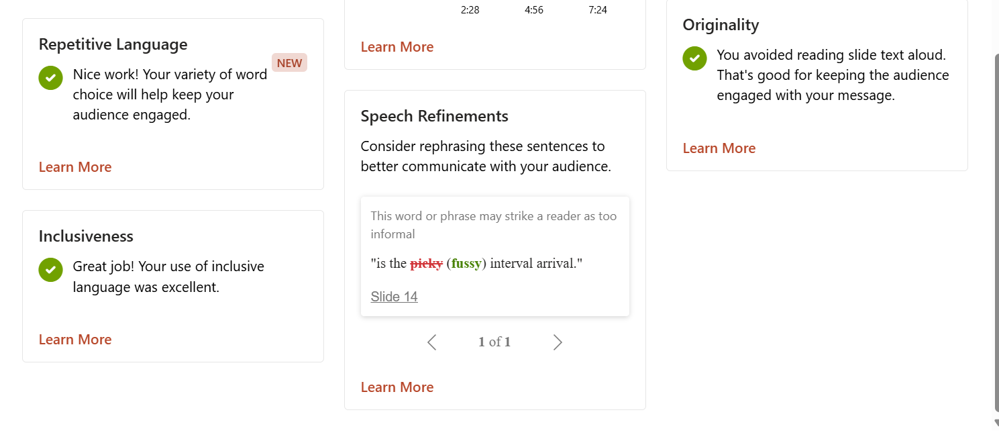

# A2 Rehearsal Presentation Feedback
[Link of rehearsal](https://mailntustedutw-my.sharepoint.com/:v:/g/personal/m11502215_ms_ntust_edu_tw/IQD-RoKREemARaEQzmiPsv-xAUSzuZkYJzraOEWJGjdJWyQ?nav=eyJyZWZlcnJhbEluZm8iOnsicmVmZXJyYWxBcHAiOiJPbmVEcml2ZUZvckJ1c2luZXNzIiwicmVmZXJyYWxBcHBQbGF0Zm9ybSI6IldlYiIsInJlZmVycmFsTW9kZSI6InZpZXciLCJyZWZlcnJhbFZpZXciOiJNeUZpbGVzTGlua0NvcHkifX0&e=YN2fBg)
## Speaker Coach Recording

### Summary of Results

| Metric | Result | Assessment |
|---|---|---|
| Total time | 9:57 for 16 slides | ✅ ~37 s per slide, well balanced |
| Pace | 118 words/min on average | ✅ Within the target range (100–150) |
| Fillers | "umm" | ⚠️ Needs improvement |
| Pitch | Mostly near the monotone line | ❌ Main weakness |
| Repetitive language | Passed | ✅ |
| Inclusiveness | Passed | ✅ |
| Originality | Did not read slide text aloud | ✅ |
| Speech refinement | Slide 14: "picky" → "fussy" | ⚠️ Likely a speech-recognition error (see below) |

### Analysis

1. **Low pitch variation (top priority).**
   The pitch curve stays close to the monotone line for the whole talk. There are only a few small peaks between 3:25 and 6:40, and it never reaches the target band. Technical talks often end up flat like this, and the audience may lose interest in the middle section.
   - Raise the tone and slow down when stating key numbers and conclusions (e.g., XR traffic results, throughput and delay comparisons).
   - Add vocal variation in transition sentences between slides (e.g., "Next, let's look at the results...").
   - Mark one or two keywords to emphasize on each slide in the script.

2. **Pace is steady, with a few dips.**
   The average of 118 wpm is good, and most of the talk stays in the 100–150 band. Around 3:00 and 5:00 the pace drops below 100. This is usually hesitation while thinking about the next sentence, which may be when the fillers appear too.

3. **Filler word "umm".**
   Replace fillers with a short pause (about half a second). A silent pause sounds more confident to the audience. Most fillers happen at slide transitions, so rehearse the opening sentence of each slide.

4. **Slide 14: "picky".**
   The recognized sentence was *"is the picky interval arrival"*. This is most likely a misrecognition of **"packet inter-arrival"**, so the "fussy" suggestion does not apply. However, it shows that the term was not articulated clearly. Pronounce **packet** clearly (the /æ/ vowel and the final /t/), and slow down on *inter-arrival time*.

### Action Items for Next Rehearsal

1. Increase pitch variation: emphasize key numbers and conclusions.
2. Replace "umm" with short pauses.
3. Articulate technical terms clearly and slowly (especially on Slide 14).
4. Keep the current total time and pace.

