# A2 - ns-3 Setup and 3GPP Traffic Model

## Assignment


Goal: install and build ns-3, run my own simulation, and verify the traffic model with packet-size and inter-arrival distributions.

## Platform and ns-3 Version

My recorded platform for the ns-3 build:

| Item | Value |
|---|---|
| OS | Ubuntu 22.04.5 LTS |
| Compiler | GCC/G++ 11.4.0 |
| Python | 3.10.12 |
| CMake | 4.4.3 after update |
| Ninja | 1.10.1 |
| ns-3 tree | `ns-3-dev` |
| ns-3 version file | `3-dev` |
| Git describe recorded during install | `ns-3.48-192-g9611dfcb5` |

The installation screenshots and earlier command notes are in `Installation.md`.

## What Broke

The first configure attempt failed because Ubuntu 22.04's default CMake was too old for this ns-3 checkout. I fixed it by adding the Kitware apt repository and installing a newer CMake package, then reran:

```bash
./ns3 configure --enable-examples --enable-tests
./ns3 build
```

## Traffic Model: 3GPP TS 26.926

3GPP TS 26.926 (*Traffic Models and Quality Evaluation Methods for Media and XR Services in 5G Systems*) defines traffic models for XR and cloud-gaming media. I implemented the downlink XR video model with **dual eye buffers** from **TS 26.926 clause 6.5.3.1, Table 6.5.3.1-1** ("Statistical parameter values for dual eye buffer frame size"). The table takes its parameters from 3GPP TR 38.838 (XR evaluation for NR). Left and right eye are two video streams that share the total bit rate `R`, and each eye buffer produces one frame every `1/F`:

| Item | TS 26.926 Table 6.5.3.1-1 (TR 38.838) | Value used |
|---|---|---|
| Eye buffers | 2 (left / right eye), same render time | 2 |
| Frame rate | Fixed `F` fps per eye buffer, nominal arrival every `1/F` | 60 fps → 16.667 ms |
| Mean bit rate | `R` | 30 Mbps |
| Frame size | Truncated Gaussian, mean `M = R×1e6/(2×F)/8`, STD 10.5% of M, range [50%, 150%] of M | M = 31,250 B, STD 3,281 B, range [15,625, 46,875] B |
| Frame jitter | Truncated Gaussian added on top of periodic arrivals (clause 6.5.3.2, values from TR 38.838): mean 0, STD 2 ms, range [-4, 4] ms | same (default) |
| Frame arrival time | `t_k = k/F + jitter_k`, drawn independently for each eye buffer | — |

Table 6.5.3.1-1 also lists optional values: STD 4% of M, range [88%, 112%]. Table 6.5.3.1-2 (P-trace analysis; the spec labels it 6.5.3.1-1 by mistake) shows that real VR traces with 30–45 Mbps have a STD/mean of about 2–15%, which is consistent with the 10.5% statistical model. TS 26.926 clause 5.6.2 describes the full trace-based encoder/decoder model (V-Trace → S-Trace). This assignment uses the simplified statistical model instead: 1 slice per frame, no encoder simulation.

Clause 6.5.3.2 does not give its own jitter table. It states that "the jitter statistical model refers to the description in TR 38.838 ... modelled as a random variable added on top of periodic arrivals, which follows truncated Gaussian distribution", so the default run uses the TR 38.838 values.

The P-trace analysis in the same clause (Table 6.5.3.2-1, Figure 6.5.3.2-1) shows larger jitter in real traces: per-trace STD 4.0–5.3 ms, min/max up to about ±19 ms, 5%–95% range about [-8.8, +8.4] ms. The clause summarises this as **mean 0 ms, STD 5 ms, range [-8, 8] ms**. I run this as a second scenario (`--jitterStd=5 --jitterBound=8`) to compare with the TR 38.838 baseline. Because ±8 ms is still smaller than half the frame period (8.33 ms), frames of one eye buffer never reorder.

Because the jitter range (±4 ms) is smaller than half the frame period, frames never reorder. The inter-arrival time between two frames is `1/F + J(k+1) - J(k)`, so its theoretical PDF is the jitter PDF convolved with itself and shifted by 16.667 ms.

ns-3 has no built-in TS 26.926 application, so I wrote one with AI assistance (`XrVideoSource` in `src/a2_xr_traffic.cc`):

- `NormalRandomVariable` with the `Bound` attribute gives the truncated Gaussian: ns-3 redraws until `|x - mean| <= Bound`.
- At the frame time, the frame is split into UDP packets of at most 1472 bytes of UDP payload (1500-byte IP packets). Each packet carries a 12-byte `SeqTsHeader` (sequence number + send timestamp), so the receiver can measure delay.

## Scenario

Source: `A2-ns3-setup/src/a2_xr_traffic.cc`. A one-line wrapper `ns-3-dev/scratch/a2_xr_traffic.cc` includes it so that ns-3 builds it as a scratch program.

```text
XR server (node 0) ---- point-to-point ---- XR client (node 1)
10.13.0.1          100 Mbps, 5 ms delay          10.13.0.2
UDP XR video source  ───────────────────────►  UDP sink, port 5000
```

- 60 s of traffic → 3600 periods × 2 eye buffers = 7200 frames (about 157k packets), enough samples for the distributions
- `--eyeBuffers=1` switches to a single-stream model (mean `R/(8F)`)
- device queue 1000 packets, so a full frame burst never drops
- RNG seed 20261013, run 1 (reproducible)

Run command:

```bash
cd ns-3-dev
./ns3 build a2_xr_traffic
./ns3 run "scratch/a2_xr_traffic --outputDir=../A2-ns3-setup/results"
cd ..
python3 A2-ns3-setup/src/plot_a2_distributions.py

# Scenario 2: jitter observed in the TS 26.926 P-traces (STD 5 ms, [-8, 8] ms)
cd ns-3-dev
./ns3 run "scratch/a2_xr_traffic --jitterStd=5 --jitterBound=8 --outputDir=../A2-ns3-setup/results/ptrace_jitter"
cd ..
python3 A2-ns3-setup/src/plot_a2_distributions.py --results A2-ns3-setup/results/ptrace_jitter
```

Output in `A2-ns3-setup/results/`:

| File | Content |
|---|---|
| `xr_frames.csv` | per frame: nominal time, generation time, jitter, size, number of packets |
| `xr_rx_packets.csv` | per received packet: time, seq, frame id, UDP payload size, one-way delay |
| `xr_model.csv` | model parameters used by the run (read by the plot script) |
| `xr_summary.txt` | throughput, packets sent/received, mean packet delay |
| `xr_video_client.pcap` | client-side link capture, first 2 s only (open in Wireshark) |
| `xr_distribution_summary.txt` | distribution statistics, KS test, frame delay |
| `frame_size_pdf_cdf.png` | frame size PDF/CDF vs theory |
| `frame_jitter_pdf_cdf.png` | jitter PDF/CDF vs theory |
| `frame_interarrival_pdf_cdf.png` | frame inter-arrival PDF/CDF vs theory |
| `packet_size_pdf_cdf.png` | IP packet size seen at the client |
| `packet_interarrival_pdf_cdf.png` | packet inter-arrival seen at the client (log scale) |

## Verification Method

1. **Model level (what TS 26.926 defines):** frame size, jitter, and frame inter-arrival are plotted as PDF and CDF, with the theoretical curve on top. The Kolmogorov–Smirnov statistic `D` is compared with the 5% critical value `1.36/√n` (≈ 0.016 for n = 7200). If `D` is below it, the generated data is consistent with the specified distribution.
2. **Network level (what the receiver sees):** each frame turns into a burst of full-size 1500-byte packets plus one smaller last fragment. The packet inter-arrival is multi-modal (see Results):
   - back-to-back packets inside a burst: 1502 B × 8 / 100 Mbps ≈ **0.12 ms**
   - gap between bursts: about one frame period minus the burst duration
3. **Sanity checks:**
   - throughput ≈ 30 Mbps × (1 + header overhead)
   - packet delay = 5 ms propagation + queueing behind earlier packets of the same frame
   - frame delay (last packet received − frame generation) ≈ 5 ms + 22 × 0.12 ms ≈ 7.6 ms, plus extra queueing when both eye frames arrive close together

## Results

Both scenarios use the same seed (20261013, run 1), so frame sizes are identical. Only the jitter differs.

- **Scenario 1 (baseline):** TR 38.838 jitter, STD 2 ms, ±4 ms. Output in `results/`.
- **Scenario 2:** TS 26.926 P-trace jitter, STD 5 ms, ±8 ms. Output in `results/ptrace_jitter/`.

### Run summary

| Metric | Scenario 1 (2 ms, ±4) | Scenario 2 (5 ms, ±8) |
|---|---|---|
| Frames generated | 7200 (3600 periods × 2 eyes) | 7200 |
| Packets sent / received | 157,827 / 157,827 (0 loss) | 157,827 / 157,827 (0 loss) |
| UDP payload bytes received | 227,104,989 | 227,104,989 |
| Throughput (UDP payload incl. 12-byte SeqTs header) | 30.28 Mbps | 30.28 Mbps |
| Throughput (video data only) | 30.03 Mbps | 30.03 Mbps |
| Mean one-way packet delay | 6.873 ms | 6.621 ms |
| Max packet delay | 11.093 ms | 11.756 ms |
| Frame delay mean / p95 / max | 8.060 / 9.895 / 11.093 ms | 7.807 / 9.448 / 11.756 ms |

**Sanity checks:**
- **Throughput:** the video data rate of 30.03 Mbps matches the configured R = 30 Mbps. The extra 0.25 Mbps is the 12-byte SeqTs header × 157,827 packets.
- **First-packet delay:** the first packet arrives with a delay of 5.120 ms (`xr_rx_packets.csv`). This is 5 ms propagation + 1502 B × 8 / 100 Mbps = 0.120 ms serialization, exactly as expected.
- **Frame delay:** one eye frame has 22 packets on average (157,827 / 7200 = 21.9), so the last packet arrives about 5 + 22 × 0.12 ≈ 7.6 ms after generation. The measured mean of 8.06 ms is slightly higher because the two eye frames of the same period often overlap, and the second one queues behind the first.

### Traffic model verification (KS test, n = 7200, 5% critical value = 0.0160)

| Distribution | Measured (Sc. 1) | Theory (Sc. 1) | KS D (Sc. 1) | Measured (Sc. 2) | Theory (Sc. 2) | KS D (Sc. 2) |
|---|---|---|---|---|---|---|
| Frame size mean / STD | 31,279 / 3,265 B | 31,250 / 3,281 B | 0.0106 | same | same | 0.0106 |
| Jitter mean / STD | 0.007 / 1.739 ms | 0 / 1.759 ms* | 0.0086 | −0.005 / 3.869 ms | 0 / 3.877 ms* | 0.0071 |
| Frame inter-arrival mean | 16.667 ms | 16.667 ms | 0.0069 | 16.666 ms | 16.667 ms | 0.0058 |

\* Truncation reduces the STD. A Gaussian with σ = 2 ms cut at ±4 ms (±2σ) has STD 0.880σ = 1.759 ms. A Gaussian with σ = 5 ms cut at ±8 ms (±1.6σ) has STD 0.775σ = 3.877 ms. The measured values match these truncated STDs, not the untruncated σ.

All KS statistics are well below 0.0160. The generated frame size, jitter, and frame inter-arrival are therefore consistent with the TS 26.926 / TR 38.838 distributions at the 5% level.

#### Frame size (Scenario 1)
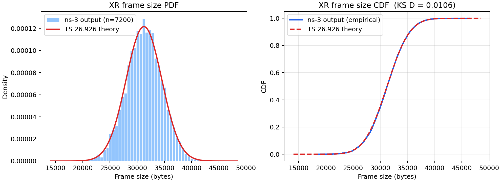

#### Frame jitter
Scenario 1:
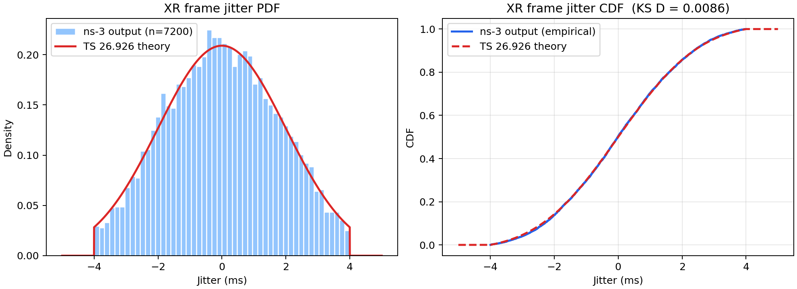

Scenario 2. The truncation edges at ±8 ms are visible:
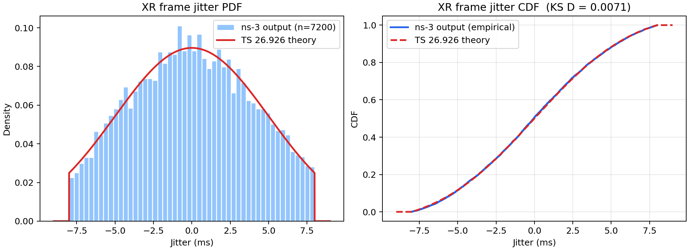

#### Frame inter-arrival
Inter-arrival = 16.667 ms + J(k+1) − J(k). The theory curve is the jitter PDF convolved with itself, which has a triangular-like shape with range ±8 ms (Sc. 1) or ±16 ms (Sc. 2).

Scenario 1:
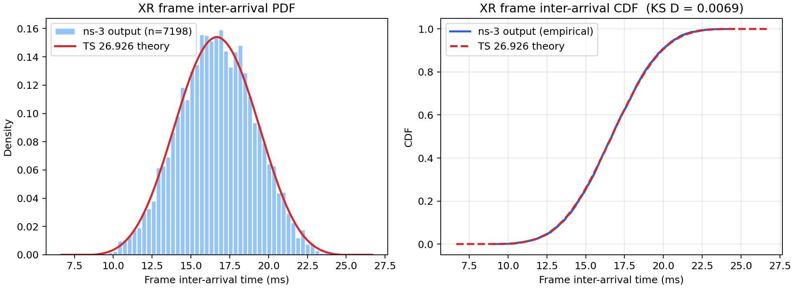

Scenario 2:
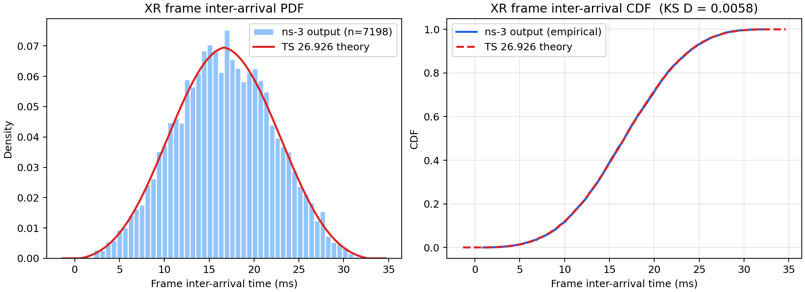

### Network-level view at the receiver

#### IP packet size
About 95.4% of packets are full 1500-byte IP packets. The remaining 4.6% are the last fragment of each frame (7200 frames → 7200 short packets), spread roughly uniformly between 41 and 1500 B (log-scale y-axis).

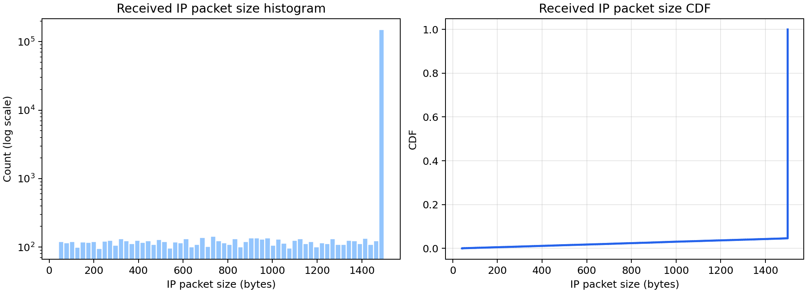

#### Packet inter-arrival
The packet inter-arrival is multi-modal (log scale on both axes):

| Range | Meaning |
|---|---|
| **0.1202 ms spike** (median) | back-to-back full-size packets: 1502 B × 8 / 100 Mbps |
| **< 0.12 ms** | a short last fragment is serialized faster than a full packet |
| **0.2 – 5 ms** | gap between the left- and right-eye frames of the same period (their jitter difference) |
| **≈ 10 – 17 ms** | gap between periods (16.667 ms minus the burst duration) |

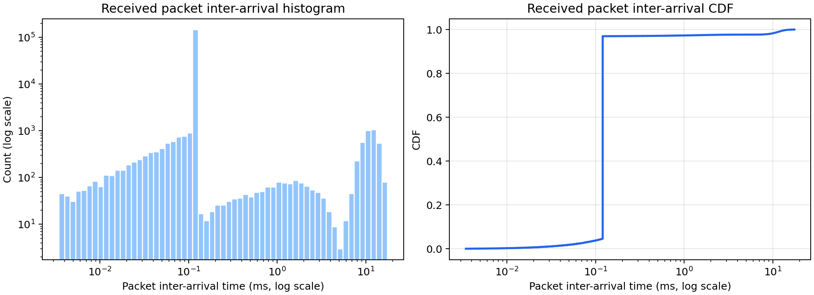

### Effect of larger jitter (Scenario 1 vs 2)

- **Frame-level distributions:** the frame inter-arrival distribution becomes much wider (±16 ms instead of ±8 ms). The receiver would need a larger de-jitter buffer to play frames out smoothly.
- **Mean delay:** the mean frame delay decreases slightly, from 8.06 to 7.81 ms. With larger jitter, the left- and right-eye frames of one period are spread further apart, so they overlap less often and the second frame waits less in the link queue.
- **Maximum delay:** the maximum delay increases, from 11.09 to 11.76 ms. Occasional large jitter values push frames close to the next period's frames, so bursts from two periods can queue together.
- **Takeaway:** on a 100 Mbps link at 30% load, jitter mainly affects frame timing regularity, not the link delay. On a loaded wireless link the overlap effect would be stronger.

### PCAP opened in Wireshark

`results/xr_video_client.pcap` (Scenario 1) holds the first 2 s of traffic on the client-side link, using the PPP link type. The PCAP and the ns-3 CSV traces agree packet for packet.

#### Packet list: one frame burst
Display filter `udp.dstport == 5000`. Time format: *Seconds Since Previous Displayed Packet*.

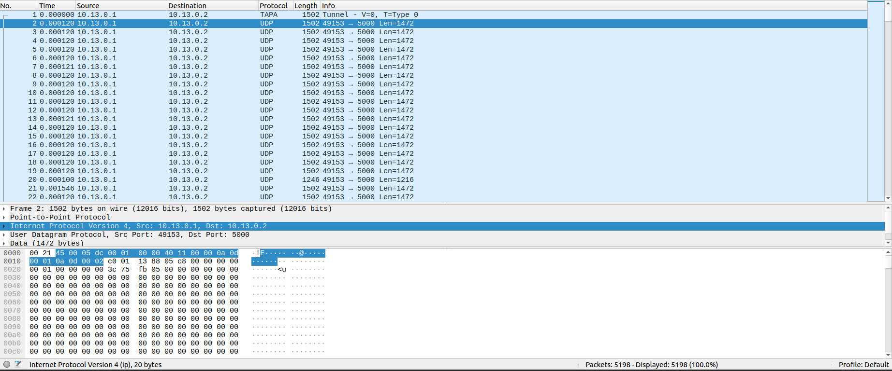

| What Wireshark shows | Explanation | Matches ns-3 trace |
|---|---|---|
| Packets 1–19: 1502 B, gap **0.000120 s** | full 1500-byte IP packet + 2-byte PPP header, serialized back-to-back at 100 Mbps: 1502 × 8 / 100e6 = 0.120 ms | — |
| Packet 20: **1246 B** (UDP Len 1216), gap **0.000100 s** | last fragment of frame 0. A shorter packet takes less time on the wire: 1246 × 8 / 100e6 = 0.0997 ms | frame 0 = 28,944 B = 19 × 1460 + 1204 → **20 packets** (`xr_frames.csv`: `size_bytes=28944, num_packets=20`) |
| Packet 21: gap **0.001546 s** | first packet of frame 1 (the other eye buffer) | frame 0 generated at 1.014365 s, frame 1 at 1.018173 s (jitter −2.30 ms vs +1.51 ms). Frame 0 ends after 2.383 ms of serialization, so the predicted gap is 1.018173 + 0.120 − (1.014365 + 2.383) = **1.545 ms** ✓ |
| Hex `00 21` | PPP protocol field = IPv4 | — |
| Hex `45 00 05 dc … 40 11` | IPv4, total length 0x05dc = 1500, TTL 64, protocol 17 (UDP) | — |
| Hex `c0 01 13 88 05 c8` | UDP 49153 → 5000, length 0x05c8 = 1480 (8 + 1472) | — |
| Payload `00 00 00 01` + `00 00 00 00 3c 75 fb 05` | `SeqTsHeader`: seq = 1, timestamp 0x3c75fb05 = 1,014,364,933 ns = **1.014364933 s** | exactly the generation time of frame 0 in `xr_frames.csv` ✓ |

Packet 1 is shown as "TAPA Tunnel" because a Wireshark heuristic dissector misreads the SeqTs payload as the TAPA protocol. It is the same UDP packet as the others. To avoid this, uncheck TAPA in `Analyze → Enabled Protocols`.

#### I/O Graph: 1 ms interval, zoomed to the first 0.1 s
Line style, X axis zoomed only, using the `x` key.

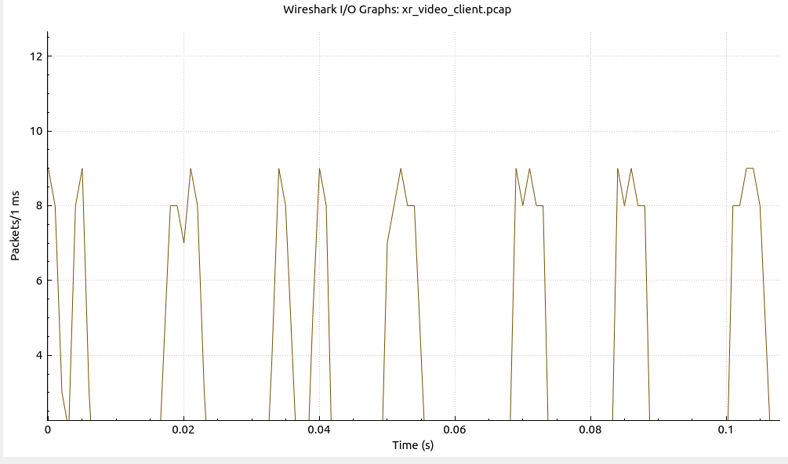

- **60 fps period:** bursts start at about 0, 17, 34, 50, 69, 84, and 101 ms, roughly every **16.7 ms**. The spacing is not exactly 16.7 ms because of the frame jitter.
- **Two eye buffers:** each period contains two frames (left and right eye).
  - At 0 ms the two frames are clearly separated. Frame 0 starts at 0 ms and frame 1 at about 3.9 ms, which matches the jitter values −2.30 ms and +1.51 ms in `xr_frames.csv`.
  - At 34 / 40 ms they are separated by about 6 ms.
  - In other periods the jitter difference is small, so the two bursts merge into one wider burst of about 5 ms.
- **Peak height:** 8–9 packets per 1 ms bin, which is the link limit: 1 ms / 0.120 ms ≈ 8.3 full-size packets.
- **Idle time:** the link is idle between bursts. 30 Mbps of video on a 100 Mbps link is about 30% load.

Full 2 s view: the same pattern repeats for the whole capture.

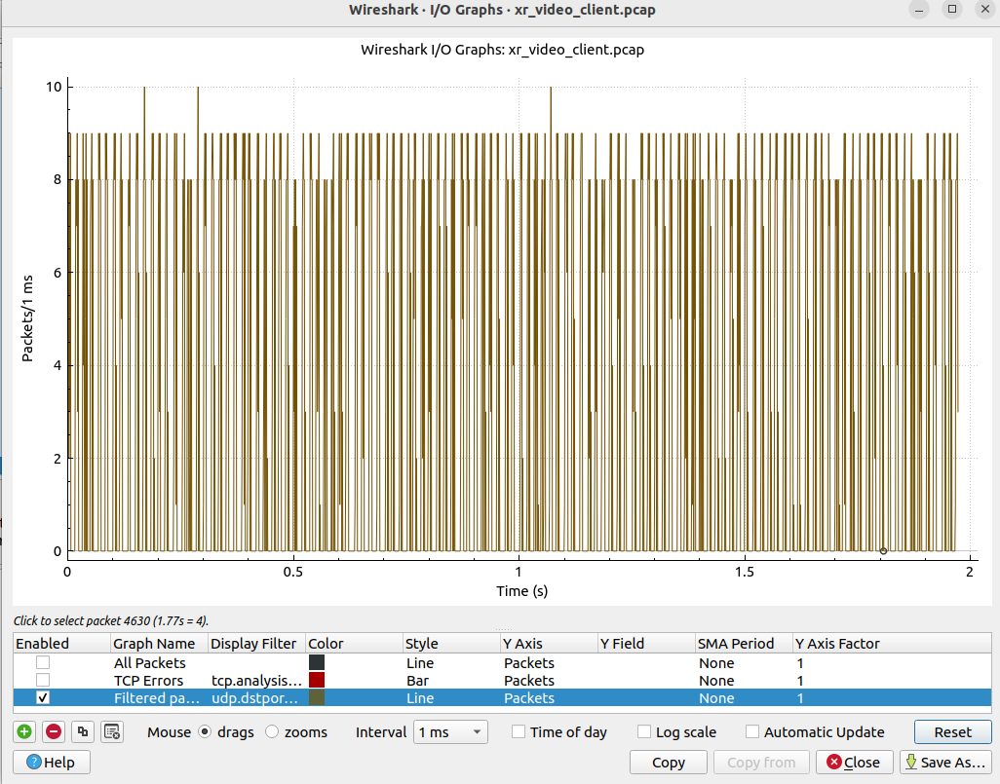

#### Conversations (UDP)
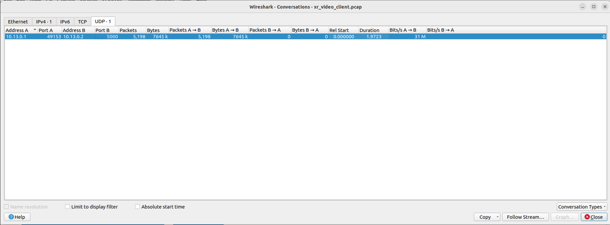

| Wireshark | Value | Cross-check |
|---|---|---|
| Packets | 5,198 | 157,827 packets / 60 s × 2 s ≈ 5,261 ✓ |
| Bytes | 7,645 kB | — |
| Duration | 1.9723 s | first 2 s of the run |
| Bits/s A → B | 31 Mbps | 7,645 kB × 8 / 1.9723 s ≈ 31.0 Mbps = 30 Mbps video + SeqTs, UDP, IP, and PPP headers ✓ |
| Packets B → A | 0 | one-way downlink stream; UDP has no ACKs |

## Presentation Talking Points

1. Installed and built ns-3 on Ubuntu 22.04 and fixed the CMake version problem.
2. Studied 3GPP TS 26.926 and implemented its dual-eye-buffer XR video model (Table 6.5.3.1-1) as an ns-3 application: 2 × 60 fps frames, truncated-Gaussian frame size and jitter.
3. Proof the run is mine: CSV traces, a throughput/delay summary, and a PCAP opened in Wireshark. The SeqTs timestamp in the packet hex (0x3c75fb05 = 1.014364933 s) equals frame 0's generation time in my CSV.
4. Verification: the frame-size, jitter, and inter-arrival PDF/CDF match the theoretical curves. All KS D are ≤ 0.0106, below the 5% critical value of 0.0160. Throughput is 30.03 Mbps of video data for a 30 Mbps target, with 0 loss.
5. Network view: a frame becomes a burst of 1500-byte packets 0.12 ms apart, which explains the packet-level distributions and the 8.06 ms mean frame delay.
6. Jitter comparison: the TS 26.926 P-trace jitter (5 ms, ±8 ms) widens frame inter-arrival to ±16 ms. The mean delay barely changes (8.06 → 7.81 ms), but timing regularity gets worse.
