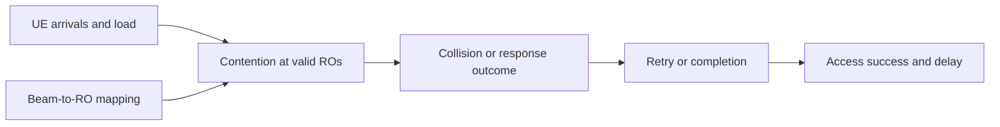

# A3 Literature Review Study Note
**Project:** Performance Evaluation of 3GPP NR-NTN 2-Step Random Access under LEO Satellite Conditions  

**Student:** M11502215 / Lucy  

**Assignment:** A3 — Literature Review  

**Submission deadline:** 2026-11-10 23:59 (Asia/Taipei)  

**Presentation:** 2026-11-17 (10 minutes)

## 1. Research Motivation and Scope
Random Access (RA) lets multiple user equipments (UEs) request access through a limited set of contention resources. In a low Earth orbit (LEO) non-terrestrial network (NTN), contention is combined with longer propagation timing than in a terrestrial cell. Insufficient resources increase collisions and retransmissions, while propagation affects the elapsed time between an access transmission and its response.

This review reads two IEEE papers to answer three questions that shape the revised project proposal:

- **Q1 — Load:** How do the cited works model the effect of UE population on collisions, retries, and access success?
- **Q2 — Resources:** How are RA resources (beams, ROs, preambles, resource blocks) configured, and which settings are needed to reproduce the reported results?
- **Q3 — LEO/NTN:** What changes when random access moves from a terrestrial cell to a LEO satellite (limited active beams, uneven demand, longer propagation)?

A3 does not require experiments. For each paper, this note records (1) problem, importance, and challenges; (2) the system model: environment, inputs, outputs, and metrics; and (3) the key results and the settings needed to reproduce them. Section 5 explains how the review changed the A1 proposal.

### 1.1 Source and Parameter Provenance
| Label | Meaning |
| --- | --- |
| `PAPER` | Explicitly reported in the cited paper or accessible author version. |
| `DECK` | Recorded from the supplied meeting deck summarizing the paper; to be cross-checked against the full text. |
| `3GPP` | Defined or constrained by an identified 3GPP specification. |
| `ASSUMPTION` | Selected for the planned simulation abstraction; not presented as a paper or standard value. |
| `DERIVED` | Calculated from stated inputs and explicit assumptions. |
| `UNAVAILABLE` | Not reported in the accessible source or not independently verifiable. |

The selected papers provide motivation, modeling concepts, and reproduction settings for the later baseline work.

## 2. Paper 1 — Beam-Based Random Access in Terrestrial NR
**Reference:** T.-A. Lin and R.-G. Cheng, “Analytical Modeling and Performance Evaluation of Beam-Based Random Access Protocol for 5G Beamforming Networks,” **IEEE Internet of Things Journal**, vol. 10, no. 24, pp. 22246–22255, Dec. 2023, doi: [10.1109/JIOT.2023.3305547](https://doi.org/10.1109/JIOT.2023.3305547).

**Verification limit:** Bibliographic metadata and the abstract were verified. The experimental settings in §2.4 were recorded from the supplied meeting deck that summarizes the paper (`DECK`). The exact recurrence equations, simulation horizon, and seed policy were not available and are marked `UNAVAILABLE` rather than inferred.

### 2.1 Problem, Importance, and Challenges
- **Problem:** Evaluate random-access performance in beamforming networks where bursty IoT traffic competes for beam-associated PRACH occasions.

- **Importance:** Beam-to-RO mapping can create uneven contention or underused access resources and therefore affects access success and delay.

- **Challenges:** Multiple beams, mapping patterns, traffic arrivals, and retry/backoff behavior create dependencies across RA opportunities. A single homogeneous contention-pool approximation cannot represent every mapping.

- **Limitation for my project:** The paper is terrestrial and is not verified as an NTN or NR 2-Step MsgA/MsgB study.

### 2.2 System Model, Inputs, and Outputs
| Element | Description | Provenance |
| --- | --- | --- |
| Environment | Terrestrial 5G beamforming network | PAPER |
| Actors | Sporadically active IoT devices and a beamforming network | PAPER |
| Traffic | Bursty arrivals | PAPER |
| RA resources | Beam-related PRACH occasions | PAPER |
| Inputs | Load, UE density, beam mapping, access configuration, channel conditions | PAPER |
| Outputs | Random-access success behavior and delay | PAPER |
| Method | Analytical model checked by computer simulation | PAPER |
| Exact state equations / ICE recursion | Not verified from full text | UNAVAILABLE |
| Exact RA procedure type | Must not be inferred as NR 2-Step RA | UNAVAILABLE |

This diagram is a conceptual summary, not a reproduction of a paper figure.

### 2.3 Analytical Approach and Metrics
The paper motivates explicit accounting for contention choices and unsuccessful attempts. Its original equations remain `UNAVAILABLE` in the verified material.

A useful sanity check for any later simulator is the one-shot case: \(M\) synchronized UEs select independently and uniformly from \(R\) resources. The no-collision probability of a tagged transmission is

\[
P_{\mathrm{no\ collision}}=\left(1-\frac{1}{R}\right)^{M-1}.
\]

This formula is `DERIVED` under these simplifying assumptions. It is not attributed to Lin and Cheng and is not a complete multi-attempt RA success probability.

**Performance metrics** (paper): RA success probability and access delay, evaluated as a function of the UE population \(M\), shown as CDFs at \(M = 1000\).

### 2.4 Experimental Settings Needed for Reproduction
| Category | Setting / status | Provenance |
| --- | --- | --- |
| Topology / network | Beam-based 5G network; exact UE spatial placement not stated | DECK / UNAVAILABLE |
| Traffic / load | UE population \(M\) varied; \(M = 1000\) in the displayed CDFs | DECK |
| PHY / MAC | RA patterns (ii)–(iv): \(R = 112 / 224 / 448\); \(J = 6 / 1 / 1\); \(C = 1 / 3 / 3\); \(T = 60 / 60 / 120\) | DECK |
| RA resource rate | \(R \times J \times C / T = 11.2\) for every listed pattern, so the patterns differ in structure, not total resource rate | DECK / DERIVED |
| Retries / backoff | \(N_{\mathrm{PTmax}} = 5\) preamble transmissions; backoff window \(W_{\mathrm{BO}} = 120\) in the displayed figure | DECK |
| Simulation horizon | Not specified; the RA period \(T\) must not be confused with the full run duration | UNAVAILABLE |
| Independent seeds / runs | Not specified; consult the full paper before exact replication | UNAVAILABLE |

**Key results:** The analytical model matches computer simulation across the evaluated scenarios. Because the RA patterns share the same resource rate (11.2), differences between them isolate the effect of how beams map to ROs, not the amount of resource.

**Relevance to my project:** resource-aware collision modeling, retransmission accounting, and analytical-versus-simulation validation.

**Not covered here:** the original recurrence equations and an exact reproduction of the numerical figures.

## 3. Paper 2 — Grant-Free Random Access and Beam Hopping in LEO
**Reference:** S. Jeon, S. Kim, G. Im, and Y.-S. Jeon, “Beam-Hopping Pattern Design for Grant-Free Random Access in LEO Satellite Communications,” **IEEE Transactions on Wireless Communications**, vol. 25, pp. 8246–8259, 2026, doi: [10.1109/TWC.2025.3636684](https://doi.org/10.1109/TWC.2025.3636684). Author manuscript: [arXiv:2508.03391](https://arxiv.org/abs/2508.03391).

### 3.1 Problem, Importance, and Challenges
- **Problem:** Design beam-hopping patterns for geographically unbalanced grant-free traffic under a limit on simultaneous satellite beams.

- **Importance:** Fixed illumination can waste satellite resources when demand differs across cells and can leave weakly served cells with poor access performance.

- **Challenges:** Limited active beams, resource collisions within cells, inter-beam interference, decoding failures, and discrete beam-pattern decisions.

- **Limitation for my project:** Grant-free data transmission is not identical to 3GPP NR 2-Step RA and does not define the same MsgA/MsgB completion event.

### 3.2 System Model, Inputs, and Outputs
| Element | Description | Provenance |
| --- | --- | --- |
| Environment | Multi-beam LEO satellite network | PAPER |
| Geography | Earth divided into H3 hexagonal cells | PAPER |
| Devices | Cell \(i\) contains \(N_i\) single-antenna devices | PAPER |
| Traffic | Each device activates with probability \(\alpha_i\) | PAPER |
| Beam constraint | At most \(N_b\) of \(N_c\) cells illuminated simultaneously | PAPER |
| Decisions | Binary cell-illumination matrix over \(N_{\mathrm{slot}}\) slots | PAPER |
| Channel | Statistical CSI and common average gain for devices in one cell | PAPER |
| Output | Cell transmission-success probability and worst-cell performance | PAPER |
| Optimization | Bisection and ADMM / \(\ell_2\)-box ADMM | PAPER |

Conceptually, a successful grant-free transmission requires both collision avoidance and decoding:

\[
P_{\mathrm{succ},i}
=P_{\mathrm{no\ collision},i}
P_{\mathrm{decode},i\mid\mathrm{no\ collision}}.
\]

This is a conditional-probability decomposition of the modeled event, not a transcription of a numbered paper equation. The high-level optimization objective is to improve the worst-served cell:

\[
\max_{\text{feasible illumination schedule}}\ \min_i P_{\mathrm{succ},i}.
\]

The expressions above are insufficient to reproduce the full optimizer without the paper's complete constraints and notation.

### 3.3 Performance Metrics
The paper's metrics target cell-level reliability and fairness:

| Metric | Interpretation / function | Provenance |
| --- | --- | --- |
| Cell success probability | \(P_{\mathrm{suc},i}(X)\): collision-free access probability × decoding-success probability | PAPER |
| Minimum cell success probability | \(\min_i P_{\mathrm{suc},i}(X)\): the worst-served cell; main max–min objective | PAPER |
| Average cell success probability | Mean across cells; paired with the minimum in the convergence analysis | PAPER |
| CDF of minimum success probability | Distribution of worst-cell reliability over evaluated realizations | PAPER |
| Convergence iterations | Success probability versus alternating-optimization iterations | PAPER |
| Scalability sensitivity | Worst-cell performance versus cell count and beam-to-cell ratio | PAPER |

Unlike Paper 1, the main goal is fairness-oriented beam scheduling, not end-to-end NR 2-Step access delay.

### 3.4 Experimental Settings Needed for Reproduction
| Parameter | Value | Provenance |
| --- | ---: | --- |
| Satellite altitude | 600 km | PAPER |
| Carrier frequency | 2 GHz | PAPER |
| UE transmit power | 23 dBm | PAPER |
| Receiver G/T | 1.1 dB/K | PAPER |
| Antenna aperture | 2 m | PAPER |
| Cells, \(N_c\) | 80 | PAPER |
| Simultaneous beams, \(N_b\) | 6 | PAPER |
| Beam-hopping slots | 64 | PAPER |
| Resource blocks | 20 | PAPER |
| Average devices per cell | 1,000 | PAPER |
| Activation probability | 0.01 | PAPER |
| Population scaling factor | 0.5 | PAPER |
| Population/uniform mixture weight | 0.3 | PAPER |
| SINR threshold | 5 dB | PAPER |
| Sampled satellite positions | 10,000 | PAPER |
| Random seed policy | Not specified in the accessible author manuscript | UNAVAILABLE |
| E2E RA simulation duration | Not defined as an RA-completion experiment | UNAVAILABLE |

These are Paper 2 settings. Its 20 resource blocks are grant-free data resources and are not equivalent to NR PRACH preambles.

### 3.5 Key Results and Limitations
The accessible author version reports improved worst-cell transmission success relative to benchmark patterns, stable binary-pattern handling with the \(\ell_2\)-box treatment, and convergence in roughly five outer iterations in the studied scenarios. Performance can decline when coverage expands into lower-elevation cells.

Relative to my project, the paper uses a different access procedure, has no explicit MsgA/MsgB outcome state machine, does not evaluate RA completion delay, and focuses on multi-beam optimization rather than a single-beam timing baseline.

## 4. Comparative Review
| Dimension | Lin and Cheng (P1) | Jeon et al. (P2) | Revised proposal (planned) |
| --- | --- | --- | --- |
| Network | Terrestrial beamforming | Multi-beam LEO | Single-beam transparent LEO |
| Access | Beam-associated RA | Grant-free data access | Simplified MsgA/MsgB 2-Step RA abstraction |
| Main constraint | Beam/RO mapping and contention | Active beams, collisions, interference | Fixed contention choices and propagation delay |
| Retries | \(N_{\mathrm{PTmax}} = 5\), \(W_{\mathrm{BO}} = 120\) | ARQ errors neglected | Uniform backoff with an attempt limit |
| PHY | Channel effects considered | Statistical decoding model (SINR threshold 5 dB) | Ideal for non-colliding transmissions |
| Timing | Terrestrial context | Not an RA-completion study | Explicit two-way propagation timing |
| Main outputs | RA success and delay vs. \(M\) | Minimum / average cell success | UE success, collision probability, attempts, RA delay |
| Optimization | Mapping evaluation | Bisection and ADMM | None (baseline) |

### 4.1 Reproduction Summary
| Item | Paper 1 | Paper 2 |
| --- | --- | --- |
| Topology | Beam-based 5G network; UE placement UNAVAILABLE | 80 H3 cells, 6 simultaneous beams, 600 km altitude |
| Traffic model | UE population \(M\) varied; \(M = 1000\) in CDFs | 1,000 devices/cell on average, activation probability 0.01 |
| PHY/MAC parameters | \(R/J/C/T\) = 112/6/1/60, 224/1/3/60, 448/1/3/120; \(N_{\mathrm{PTmax}} = 5\); \(W_{\mathrm{BO}} = 120\) | 2 GHz, 23 dBm UE, G/T 1.1 dB/K, 20 RBs, 64 hopping slots, SINR threshold 5 dB |
| Simulation time | UNAVAILABLE | 10,000 sampled satellite positions; no RA-completion duration |
| Seeds / runs | UNAVAILABLE | UNAVAILABLE |
| Reproducible from this review | Partially (horizon and seeds missing) | Partially (seed policy missing; optimizer needs full constraints) |

## 5. From the Literature to the Revised Proposal
| Source | Concept | How the revised proposal uses it | Deliberately excluded for now |
| --- | --- | --- | --- |
| Paper 1 | Beam/RO-related contention with a fixed resource rate | Fixed contention pool; collisions counted per RA occasion | Arbitrary beam-to-RO mappings |
| Paper 1 | Retry behavior (\(N_{\mathrm{PTmax}}\), backoff window) | Uniform backoff and a maximum-attempt limit | Original analytical recursion |
| Paper 1 | Analytical-versus-simulation validation | Compare simulation with the one-shot collision formula in §2.3 | Reproduction of the paper's figures |
| Paper 2 | LEO resource scarcity | Transparent LEO context with a single serving beam | Multi-beam beam hopping |
| Paper 2 | Dense access (1,000 devices/cell) | Sweep UE load up to the thousands | H3 spatial population model |
| Paper 2 | Collision versus decoding | Report collision probability separately from success | SINR-based MsgA decoding |
| 3GPP | MsgA/MsgB 2-Step concepts and NTN timing | Abstract transmission–response chain with configurable one-way delay | PRACH waveform, fallbackRAR/Msg3, complete MAC |

**Research gap:** Neither paper offers a small, inspectable ns-3 model that combines RA contention and retries with transparent-NTN propagation timing for a 2-Step MsgA/MsgB outcome. The revised proposal targets this gap without claiming full 3GPP conformance. Details are in [revised-proposal.md](revised-proposal.md).

## 6. Conclusions
Paper 1 contributes beam-aware contention modeling, concrete retry/backoff settings, and the practice of validating simulation against analysis. Paper 2 contributes LEO resource constraints, dense and uneven traffic, and fairness metrics for a future multi-beam extension. The revised project therefore begins with one beam and fixed resources, so collision counting and propagation timing can be verified before adding allocation algorithms.

This direction differs from the original A1 proposal, which studied downlink traffic-demand satisfaction with SNS-3. The changes and their reasons are documented in the [revised proposal](revised-proposal.md).

## References
[1] T.-A. Lin and R.-G. Cheng, “Analytical Modeling and Performance Evaluation of Beam-Based Random Access Protocol for 5G Beamforming Networks,” **IEEE Internet of Things Journal**, vol. 10, no. 24, pp. 22246–22255, Dec. 2023, doi: [10.1109/JIOT.2023.3305547](https://doi.org/10.1109/JIOT.2023.3305547).

[2] S. Jeon, S. Kim, G. Im, and Y.-S. Jeon, “Beam-Hopping Pattern Design for Grant-Free Random Access in LEO Satellite Communications,” **IEEE Transactions on Wireless Communications**, vol. 25, pp. 8246–8259, 2026, doi: [10.1109/TWC.2025.3636684](https://doi.org/10.1109/TWC.2025.3636684). [Author manuscript](https://arxiv.org/abs/2508.03391).

[3] 3GPP, [TS 38.300](https://portal.3gpp.org/desktopmodules/Specifications/SpecificationDetails.aspx?specificationId=3191), “NR; NR and NG-RAN Overall Description; Stage-2,” V19.4.0, Sep. 2026.

[4] 3GPP, [TS 38.321](https://portal.3gpp.org/desktopmodules/Specifications/SpecificationDetails.aspx?specificationId=3194), “NR; Medium Access Control (MAC) Protocol Specification,” V19.4.0, Sep. 2026.

[5] 3GPP, [TS 38.213](https://portal.3gpp.org/desktopmodules/Specifications/SpecificationDetails.aspx?specificationId=3215), “NR; Physical Layer Procedures for Control,” V19.5.0, Sep. 2026.

[6] 3GPP, [TS 38.211](https://portal.3gpp.org/desktopmodules/Specifications/SpecificationDetails.aspx?specificationId=3213), “NR; Physical Channels and Modulation,” V19.5.0, Sep. 2026.

[7] 3GPP, [TS 38.331](https://portal.3gpp.org/desktopmodules/Specifications/SpecificationDetails.aspx?specificationId=3197), “NR; Radio Resource Control (RRC); Protocol Specification,” V19.4.0, Sep. 2026.

[8] 3GPP, [TR 38.821](https://portal.3gpp.org/desktopmodules/Specifications/SpecificationDetails.aspx?specificationId=3525), “Solutions for NR to Support Non-Terrestrial Networks (NTN),” V16.2.0, Apr. 2023.
