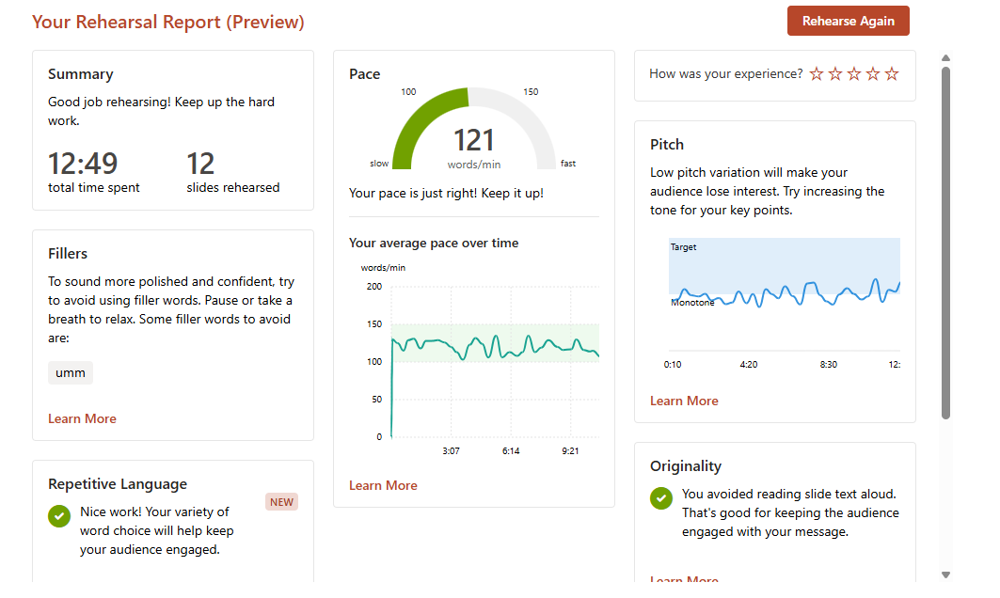
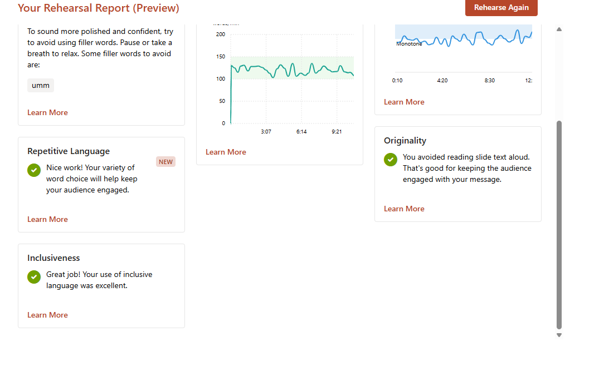

# A4 Rehearsal Presentation Feedback

[Link of rehearsal](https://mailntustedutw-my.sharepoint.com/:v:/g/personal/m11502215_ms_ntust_edu_tw/IQB38b0UxTvtSabuchDzKXK0AbJtFG3pMbWtDfQZ7gQMx6s?nav=eyJyZWZlcnJhbEluZm8iOnsicmVmZXJyYWxBcHAiOiJPbmVEcml2ZUZvckJ1c2luZXNzIiwicmVmZXJyYWxBcHBQbGF0Zm9ybSI6IldlYiIsInJlZmVycmFsTW9kZSI6InZpZXciLCJyZWZlcnJhbFZpZXciOiJNeUZpbGVzTGlua0NvcHkifX0&e=MeLMHG)

## Speaker Coach Recording

### Summary of Results

| Metric | Result | Assessment |
|---|---|---|
| Total time | 12:49 for 12 slides | ⚠️ ~64 s per slide; about 3 min shorter than the ~15.5 min in the speaker notes |
| Pace | 121 words/min on average | ✅ Inside the target range (100–150) for the whole talk |
| Fillers | "umm" | ⚠️ Needs improvement |
| Pitch | Close to the monotone line, rising slightly toward the end | ❌ Main weakness |
| Repetitive language | Passed | ✅ |
| Inclusiveness | Passed | ✅ |
| Originality | Did not read slide text aloud | ✅ |

### Analysis

1. **Low pitch variation (top priority).**
   The pitch curve stays just above the monotone line and only touches the target band in short peaks, mostly after about 8:30. The first half (paper, model, access patterns, ns-3 implementation) is the flattest. This is the same weakness as in A2, so it has not improved yet.
   - Emphasize the headline result on *res-ab* and *numbers*: "my filled markers fill the paper's hollow markers" and "0.0002 maximum difference".
   - Make the contrast between patterns clear on *patterns* and *res-ab*: pattern (ii) is best and (iii) is worst, so raise your voice on "best" and "worst".
   - Use a rising tone for the question at each section start, such as "Does ns-3 match the paper?", and a falling tone for the answer.

2. **Pace is very stable.**
   An average of 121 wpm, with the curve inside the 100–150 band from start to finish. There are no long slow-downs like in A2, so keep this pace.

3. **Total time vs. the plan.**
   The speaker notes add up to about 15.5 min, but the talk took 12:49. Either some slides were shortened, or the notes overestimate the time. Check this against the A4 time limit:
   - If the limit is around 10 min, cut about 3 min. *choices* and *diff* (~2 min each) are the best places to trim.
   - If there is more time, the dense slides (*numbers* and *choices*) can be slowed down a little, because the audience needs time to read the table.

4. **Filler word "umm".**
   Fillers still appear, but only "umm" was flagged, which is fewer types than in A3 ("umm", "like" and "I mean"). Replace them with a half-second pause, especially at slide transitions. Rehearse the first sentence of each slide.

### Comparison with Earlier Rehearsals

| | A2 | A3 | A4 |
|---|---|---|---|
| Time / slides | 9:57 / 16 | 11:07 / 17 | 12:49 / 12 |
| Pace (wpm) | 118 | 125 | 121 |
| Fillers flagged | umm | umm, like, I mean | umm |
| Pitch | Monotone | Low variation | Low variation, slightly better toward the end |

### Action Items for Next Rehearsal

1. Increase pitch variation, especially on the result slides (*res-ab*, *res-cd*, *numbers*).
2. Replace "umm" with short pauses at slide transitions.
3. Make the total time fit the A4 limit, and update the per-slide times in the speaker notes to match.
4. Keep the current pace.
