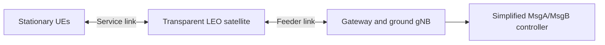
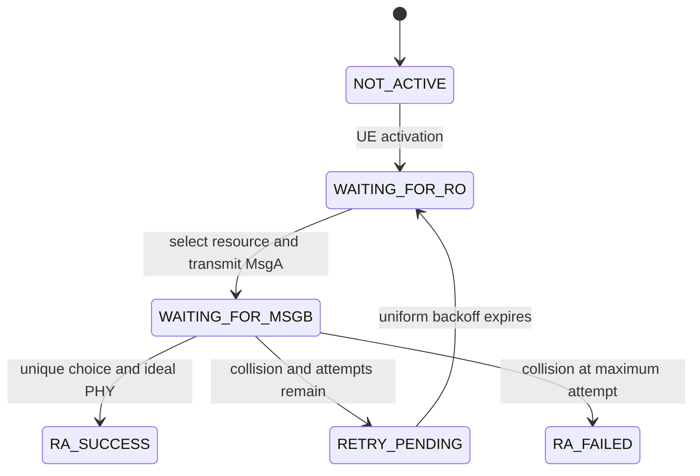
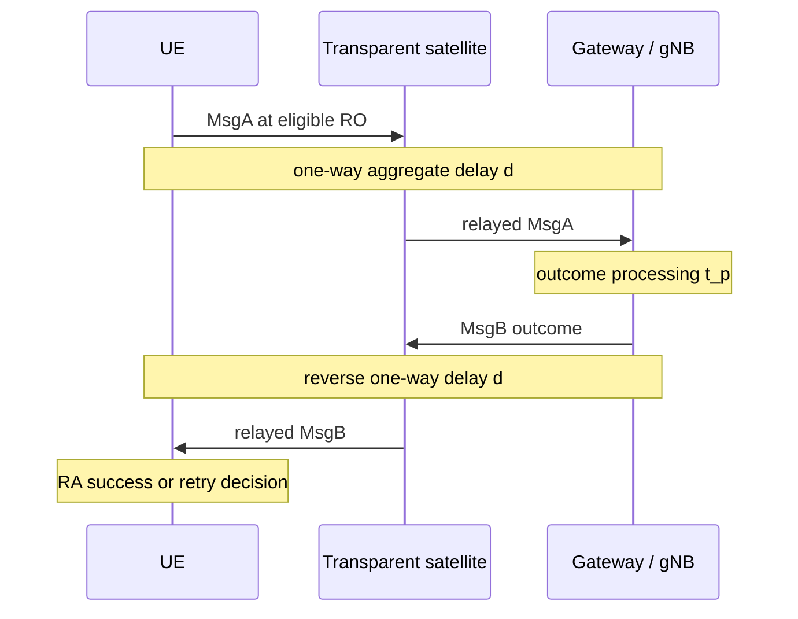

# A3 Report — NR-NTN Random Access Baseline

**Project:** Performance Evaluation of 3GPP NR-NTN 2-Step Random Access under LEO Satellite Conditions  
**Student:** M11502215 / Lucy  
**Execution date:** 2026-11-08 (Asia/Taipei)

## 1. Objective and Scope

This report consolidates the A3 system model, executable experiment, measured data, statistical interpretation, figures, limitations, and reproducibility evidence. The literature analysis is maintained in [`../study-note.md`](../study-note.md), and the A1-to-A3 change is maintained in [`../revised-proposal.md`](../revised-proposal.md).

The experiment addresses:

- **RQ1 — RA load:** How does synchronized UE load affect collision probability, UE success, attempts, and completion delay under fixed contention resources?
- **RQ2 — NTN propagation:** How does configured one-way UE-to-ground-gNB delay affect completion time when contention is removed?

The modeled end-to-end interval is `UE activation -> simplified MsgA transmission -> MsgB outcome -> RA completion`. It is a system-level abstraction, not a complete NR PHY/MAC/RRC implementation.

## 2. Implementation Summary

### 2.1 Repository and Simulator

- ns-3 checkout: `ns-3.48-188-g29f6a374c`.
- Simulator source: `../../ns-3-dev/scratch/a3-ntn-ra/ntn-ra-sim.cc`.
- ns-3 facilities: event scheduler, command-line parameters, deterministic random streams, and simulation time.
- Outputs: per-run summary CSV and optional per-UE CSV.
- Automation: `../scripts/run_experiments.py`, `../scripts/plot_results.py`, and `../tests/check_results.py`.

At each periodic modeled RA occasion, eligible UEs select contention resources. Selections are grouped by resource index. A unique selection receives a delayed success outcome; every UE in a shared selection collides. Collided UEs use uniform backoff and retry until the maximum-attempt limit.

### 2.2 System-Model Boundary

The model contains one transparent LEO satellite, one gateway/gNB, one serving beam and SSB, stationary UEs, fixed geometry, and ideal noncolliding PHY behavior. Detailed resource mapping, states, timing, and metrics are consolidated in [Appendix A](#appendix-a--detailed-system-model).

The directly configured one-way delay (d) represents the aggregate UE-to-ground-gNB path through the transparent satellite. A first-attempt success completes after

\[
D_{\mathrm{RA}}=(t_{\mathrm{RO}}-t_a)+2d+t_p,
\]

where (t_a) is activation time, (t_{\mathrm{RO}}) is the selected modeled RA occasion, and (t_p) is the abstract MsgB processing time.

## 3. Experiment Configuration

| Parameter | Value | Provenance |
| --- | ---: | --- |
| Satellite context | 600 km transparent LEO | ASSUMPTION |
| Experiment 0 UE counts | 10, 20, 40, 80, 160 | ASSUMPTION |
| Experiment 1 UE counts | 10, 20, 40, 80, 160, 320 | ASSUMPTION |
| Contention choices | 32 per modeled RO | ASSUMPTION |
| UE activation | Synchronized at 0 ms | ASSUMPTION |
| RO periodicity | 20 ms | ASSUMPTION |
| Baseline one-way delay | 8 ms | ASSUMPTION |
| MsgB processing time | 2 ms | ASSUMPTION |
| Retry backoff | Uniform 0–40 ms | ASSUMPTION |
| Maximum attempts | 4 | ASSUMPTION |
| Simulation horizon | 10 s | ASSUMPTION |
| Noncolliding PHY | Error-free | ASSUMPTION |
| RNG seed | 20261108 | ASSUMPTION |
| Independent runs | 200/point for Experiment 0; 30/point for Experiments 1–2 | ASSUMPTION |

These values are A3 experimental choices. They are not presented as paper settings or mandatory 3GPP timer values.

## 4. Metrics and Statistical Method

UE-level access success is

\[
P_{\mathrm{success}}
=\frac{N_{\mathrm{successful\ UEs}}}{N_{\mathrm{attempting\ UEs}}}.
\]

Transmission-level collision probability is

\[
P_{\mathrm{collision}}
=\frac{N_{\mathrm{collided\ preamble\ transmissions}}}
{N_{\mathrm{total\ preamble\ transmissions}}}.
\]

For successful UE (u), completion delay is

\[
D_{\mathrm{RA},u}=t_{\mathrm{completion},u}-t_{\mathrm{activation},u}.
\]

Mean and nearest-rank 95th-percentile delay include successful UEs only. Failed and unfinished UEs remain visible through terminal-state counts and the UE success denominator.

For each experiment point, the scripts aggregate independent ns-3 run numbers. Reported uncertainty is the normal-approximation 95% confidence-interval half-width

\[
h_{95}=1.96\frac{s}{\sqrt{n}},
\]

where (s) is the sample standard deviation over run-level metrics and (n) is the number of runs. This interval quantifies Monte Carlo run variation; it does not represent model uncertainty.

## 5. Experiment 0 — Analytical Collision Validation

### 5.1 Design

- **Objective:** verify one-shot collision grouping and resource selection.
- **Independent variable:** \(M=10,20,40,80,160\) simultaneous UEs.
- **Controlled variables:** \(R=32\), one attempt, synchronized activation, ideal noncolliding PHY.
- **Runs:** 200 per point; 1,000 total.
- **Analytical reference:**

\[
P_{\mathrm{no\ collision}}=\left(1-\frac{1}{R}\right)^{M-1}.
\]

### 5.2 Results

| UEs | Analytical no-collision | ns-3 estimate | 95% CI half-width | Absolute error |
| ---: | ---: | ---: | ---: | ---: |
| 10 | 0.751459 | 0.754500 | 0.024534 | 0.003041 |
| 20 | 0.547044 | 0.553000 | 0.017082 | 0.005956 |
| 40 | 0.289906 | 0.286875 | 0.010345 | 0.003031 |
| 80 | 0.081419 | 0.081688 | 0.003327 | 0.000269 |
| 160 | 0.006422 | 0.006969 | 0.000865 | 0.000547 |

All analytical values lie inside their corresponding simulated 95% confidence intervals. The largest absolute error is 0.005956 at 20 UEs. This range retains measurable noncollision events across all points and therefore provides a more informative validation than a saturated 10,000-UE point.


## 6. Experiment 1 — UE Load

### 6.1 Design

- **Objective:** measure contention effects with retries.
- **Independent variable:** 10, 20, 40, 80, 160, and 320 synchronized UEs.
- **Controlled variables:** 32 choices, 20 ms RO period, 8 ms one-way delay, 2 ms processing, uniform 0–40 ms backoff, and four attempts.
- **Runs:** 30 per point; 180 total.

### 6.2 Results and Uncertainty

Values after `±` are 95% confidence-interval half-widths across 30 run-level observations.

| UEs | UE success | Collision probability | Mean attempts | Mean successful-UE delay (ms) |
| ---: | ---: | ---: | ---: | ---: |
| 10 | 1.000000 ± 0.000000 | 0.207773 ± 0.040015 | 1.286667 ± 0.064927 | 31.533 ± 3.297 |
| 20 | 1.000000 ± 0.000000 | 0.350453 ± 0.024953 | 1.556667 ± 0.059571 | 44.967 ± 2.981 |
| 40 | 1.000000 ± 0.000000 | 0.481689 ± 0.012267 | 1.937500 ± 0.045783 | 63.450 ± 2.336 |
| 80 | 0.936250 ± 0.018135 | 0.660577 ± 0.011943 | 2.772083 ± 0.055939 | 99.691 ± 2.514 |
| 160 | 0.506042 ± 0.020308 | 0.858217 ± 0.006389 | 3.575208 ± 0.020265 | 123.001 ± 1.330 |
| 320 | 0.128958 ± 0.005880 | 0.966928 ± 0.001536 | 3.900625 ± 0.006246 | 128.095 ± 3.092 |

With 32 fixed contention choices, the offered load spans \(M/R=0.3125\) to \(10\) UEs per resource. Collision probability rises from 0.208 at 10 UEs to 0.967 at 320 UEs. The four-attempt cap maintains full measured success through 40 UEs, then success falls to 0.936 at 80 UEs, 0.506 at 160 UEs, and 0.129 at 320 UEs. Every point retains successful samples, so conditional completion delay remains measurable while the sweep still reaches severe congestion.

The decreasing collision-probability interval width at high load does not imply low congestion uncertainty; it reflects that nearly every transmission collides in every run, concentrating the run-level ratio near one.


## 7. Experiment 2 — Propagation-Delay Sensitivity

### 7.1 Design

- **Objective:** isolate placement of forward and reverse propagation delay.
- **Independent variable:** one-way delay (d=4,8,12,16,20) ms.
- **Controlled variables:** 20 UEs assigned distinct fixed indices among 32 choices, ideal PHY, and 2 ms processing.
- **Runs:** 30 per point; 150 total.

Distinct assignments remove contention and retries, so propagation is the only changing timing component.

### 7.2 Results

| One-way delay (ms) | Mean completion delay (ms) | P95 delay (ms) | UE success |
| ---: | ---: | ---: | ---: |
| 4 | 10 | 10 | 1.0 |
| 8 | 18 | 18 | 1.0 |
| 12 | 26 | 26 | 1.0 |
| 16 | 34 | 34 | 1.0 |
| 20 | 42 | 42 | 1.0 |

Every run follows

\[
D_{\mathrm{RA}}=2d+t_p=2d+2\,\mathrm{ms}.
\]

All UEs succeed and collision probability is zero. Mean and P95 are identical, and every CI half-width is zero, because activation, resource assignment, and response timing are deterministic in this controlled scenario. This is a timing-model sanity check, not evidence for a particular NTN geometry or 3GPP response-window configuration.


## 8. Execution and Consistency Checks

| Evidence | Outcome |
| --- | --- |
| Workspace-local Windows/Zig build | PASS |
| C++ self-tests | PASS, 7/7 |
| Formal experiment runs | PASS, 1,330 total |
| Experiment 0 CSV rows | 1,000 |
| Experiment 1 CSV rows | 180 |
| Experiment 2 CSV rows | 150 |
| CSV invariants | PASS for all formal raw files |
| Experiment 2 collision / success | Maximum collision 0; minimum success 1 |
| Figures | Four PNG files generated from the formal CSV files |

Detailed versions, commands, hashes, and the Zig/ns-3 compatibility workaround are consolidated in [Appendix B](#appendix-b--execution-evidence).

## 9. Experimental Limitations

- One beam, one SSB, one gateway/gNB, and fixed geometry.
- `raResources` represents already-valid abstract contention choices; detailed PRACH and MsgA PUSCH association tables are not implemented.
- PRACH detection, MsgA payload decoding, and MsgB reception are ideal for noncolliding attempts.
- No capture, multiuser detection, interference cancellation, or inter-beam interference.
- Collision and maximum attempts are the implemented failure causes.
- Retry is an abstraction and is not standards-complete fallbackRAR/Msg3 behavior.
- Delay is directly configured; altitude, elevation, Doppler, timing advance, and scheduling offsets are not separately calculated.
- Experiment 2 intentionally excludes contention and timeout-induced failures.
- Confidence intervals describe Monte Carlo variation only and do not cover abstraction or parameter uncertainty.

## 10. Conclusions

Experiment 0 supports the correctness of one-shot resource selection and collision accounting. Experiment 1 shows that fixed contention resources become a bottleneck under synchronized load: collision, attempts, and successful-UE delay increase, while the four-attempt limit eventually reduces UE success. Experiment 2 verifies that the configured propagation delay is applied once in each direction.

These results provide a reproducible fixed-resource control case for future multi-beam and dynamic RA resource-allocation research. They do not establish full NR-NTN standards compliance.

## Appendix A — Detailed System Model

### A.1 Scope

The A3 model represents the interval:

`UE becomes active -> UE completes simplified 2-Step random access`

It excludes application delivery, 5GC signaling, user-plane throughput, handover, beam switching, and satellite mobility. It is a system-level ns-3 abstraction, not a complete NR implementation.

### A.2 Architecture



- One transparent satellite relays the signal; it does not terminate the modeled RA control procedure.
- One ground gateway/gNB handles contention outcomes and MsgB.
- One beam and one associated SSB are modeled.
- Doppler is assumed compensated.
- Geometry is fixed within a run.

### A.3 Resource Abstraction

```text
Serving beam / selected SSB
            |
            v
Valid PRACH occasion (RO) and preamble
            |
            v
Associated MsgA PUSCH occasion/resource
            |
            v
MsgA contention choice
```

The `raResources` parameter counts valid abstract MsgA contention choices available in one modeled RO. A choice represents an already-valid RO/preamble-to-PUSCH association. The simulator does not form an unrestricted Cartesian product of PRACH occasions, preambles, and PUSCH occasions.

This abstraction follows the conceptual split in 3GPP TS 38.321 clauses 5.1.2a and 5.1.4a for 2-Step RA resource selection and response reception, and TS 38.213 clauses 8.1A and 8.2A for MsgA PUSCH association and MsgB response procedures. TS 38.331 provides the RRC configuration structures; the A3 model does not encode those information elements.

### A.4 Simplified State Machine



The baseline separates resource collision from channel failure by setting PRACH detection, MsgA payload decoding, and MsgB reception to one for noncolliding transmissions. A detected preamble is not generally equivalent to MsgA success; that distinction is acknowledged but its probability model is postponed. `fallbackRAR` and Msg3 fallback are not implemented, so the retry transition must not be described as standards-complete fallback.

### A.5 Timing Model

Let:

- \(t_a\): UE activation time.
- \(t_{RO}\): first eligible periodic RO.
- \(d\): configured one-way UE-to-ground-gNB delay, including the transparent service and feeder path as one input.
- \(t_p\): abstract gNB processing time before MsgB.

For a noncolliding first attempt:

\[
t_{\mathrm{complete}}=t_{RO}+d+t_p+d
\]

\[
D_{\mathrm{RA}}=t_{\mathrm{complete}}-t_a
\]



The delay is applied exactly once in each direction. The model does not add a separate NTN scheduling offset or timing-advance compensation. Thus, `oneWayDelayMs` is a sensitivity input rather than a claim that satellite altitude alone equals the radio path length.

### A.6 Collision and Retry Model

At each periodic RO, every eligible UE independently selects one of \(R\) resources with equal probability. If two or more UEs select the same resource in the same RO, every transmission in that group collides. There is no capture, multiuser detection, or interference cancellation.

For \(M\) simultaneously contending UEs in one attempt:

\[
P_{\mathrm{no\ collision}}=\left(1-\frac{1}{R}\right)^{M-1}
\]

This is a per-transmission one-shot probability. It is not the complete UE success probability of a retrying 2-Step procedure.

After a collided attempt, the UE learns the modeled failure after \(2d+t_p\), waits a uniform random backoff in \([0,W]\), and becomes eligible for the next periodic RO. It fails permanently after `maxAttempts` collided transmissions.

### A.7 Inputs

| Parameter | Meaning | Baseline | Provenance |
| --- | --- | ---: | --- |
| `ueCount` | Offered UEs in synchronized burst | Exp. 0: 10–160; Exp. 1: 10, 20, 40, 80, 160, 320 | ASSUMPTION |
| `raResources` | Valid equiprobable choices per modeled RO | 32 | ASSUMPTION |
| `roPeriodMs` | Period between modeled ROs | 20 ms | ASSUMPTION |
| `maxAttempts` | Maximum MsgA transmissions per UE | 4 | ASSUMPTION |
| `backoffWindowMs` | Uniform backoff upper bound | 40 ms | ASSUMPTION |
| `oneWayDelayMs` | Aggregate UE-to-ground-gNB propagation delay | 8 ms baseline; 4–20 ms sweep | ASSUMPTION |
| `msgbProcessingMs` | Abstract network response processing | 2 ms | ASSUMPTION |
| `simulationDurationMs` | Fixed horizon | 10,000 ms | ASSUMPTION |
| `seed` | ns-3 RNG seed | 20261108 | ASSUMPTION |
| `run` | Independent ns-3 substream | 1…N | ASSUMPTION |
| Satellite altitude | Context for LEO scenario | 600 km | ASSUMPTION; not used to derive delay |

No table entry above is attributed to either reviewed paper or to a mandatory 3GPP timer value.

The propagation-delay experiment uses 20 UEs with distinct fixed resource indices among 32 choices. This assignment removes collisions and retries so changing delay cannot change resource eligibility or contention outcomes. Random synchronized contention is evaluated separately in Experiments 0 and 1.

### A.8 Outputs and Metrics

\[
P_{\mathrm{success}}=\frac{N_{\mathrm{successful\ UEs}}}{N_{\mathrm{attempting\ UEs}}}
\]

Each UE contributes once, regardless of retransmissions.

\[
P_{\mathrm{collision}}=\frac{N_{\mathrm{collided\ preamble\ transmissions}}}{N_{\mathrm{total\ preamble\ transmissions}}}
\]

The collision denominator is transmissions, not UEs, ROs, or occupied resources.

For successful UE \(u\):

\[
D_{\mathrm{RA},u}=t_{\mathrm{complete},u}-t_{\mathrm{activation},u}
\]

Mean and nearest-rank 95th-percentile delay are calculated only over successful UEs. Failed and unfinished counts are reported separately, with the invariant

\[
N_{\mathrm{attempted}}=N_{\mathrm{successful}}+N_{\mathrm{failed}}+N_{\mathrm{unfinished}}.
\]

### A.9 Standards Versions Checked

The 3GPP portal was checked on 2026-11-08. The verified versions were TS 38.300 V19.4.0, TS 38.321 V19.4.0, TS 38.213 V19.5.0, TS 38.211 V19.5.0, TS 38.331 V19.4.0, and TR 38.821 V16.2.0. The A3 abstraction relies on named 2-Step RA concepts and does not claim implementation of all behavior in those releases.

## Appendix B — Execution Evidence

### B.1 Verified Environment

| Tool | Version | Location or note |
| --- | --- | --- |
| ns-3 | `ns-3.48-188-g29f6a374c` | `../../ns-3-dev/` |
| CMake | 4.4.4 | Workspace-local `.tools/bin/cmake.exe` |
| Ninja | 1.13.2 | Workspace-local `.tools/bin/ninja.exe` |
| Zig | 0.17.1 | Workspace-local `.tools/ziglang/zig.exe` |
| Clang backend | 22.1.8 | Reported during CMake configuration |
| Python | 3.12.10 | Local user Python installation |
| NumPy | 1.26.4 | Experiment-analysis environment |
| Matplotlib | 3.8.4 | Noninteractive `Agg` backend |

No system `PATH` or global environment variable was modified for workspace-local CMake, Ninja, or Zig.

### B.2 Build Compatibility Finding

Zig compiles the ns-3 core source. Direct linkage against the generated Windows shared-DLL import library fails because the MinGW runtime and DLL boundary both define `atexit`. The ns-3 CMake configuration also rejects its `NS3_STATIC` option on Windows.

The project-local `.build-tools/build-ns3-a3-zig.ps1` script uses CMake and Ninja to compile ns-3 core, then links the simulator directly with 68 CMake-built core object files. This is a build-only workaround and does not modify LTE/NR protocol behavior.

Generated executable:

```text
ns-3-dev/build/scratch/a3-ntn-ra/ns3-dev-ntn-ra-sim-static.exe
```

### B.3 Commands Executed

```powershell
powershell.exe -NoProfile -ExecutionPolicy Bypass -File '.\.build-tools\build-ns3-a3-zig.ps1'
& '.\ns-3-dev\build\scratch\a3-ntn-ra\ns3-dev-ntn-ra-sim-static.exe' '--selfTest=true'

Set-Location '.\A3-literature-review'
$python = 'C:\Users\wenj\AppData\Local\Programs\Python\Python31210\python.exe'
& $python scripts/run_experiments.py
& $python tests/check_results.py results/raw/experiment_0_validation.csv results/raw/experiment_1_load.csv results/raw/experiment_2_delay.csv
& $python scripts/plot_results.py
```

### B.4 C++ Self-Tests

```text
PASS,single_ue_success
PASS,forced_collision
PASS,different_preambles
PASS,delay_sensitivity
PASS,maximum_attempts
PASS,determinism
PASS,result_conservation
```

### B.5 Formal Batch Evidence

| Raw result file | Data rows | Outcome |
| --- | ---: | --- |
| `../results/raw/experiment_0_validation.csv` | 1,000 | PASS |
| `../results/raw/experiment_1_load.csv` | 180 | PASS |
| `../results/raw/experiment_2_delay.csv` | 150 | PASS |

Total: **1,330 independent ns-3 runs**. The checker verified row counts, probability bounds, finite metrics, maximum attempts, and UE-state conservation. Experiment 2 had maximum collision probability 0 and minimum UE success probability 1.

### B.6 SHA-256 Artifact Evidence

| Artifact | SHA-256 |
| --- | --- |
| `experiment_0_validation.csv` | `826588238AFAFE4D924C6C3FB8FBA003A54E67932A4D93FF6BB799614DE99CBC` |
| `experiment_1_load.csv` | `D61E8EF57BAB7FFF315BFC78A1E7AE6A82A03B2E3953925602141EC685F398BB` |
| `experiment_2_delay.csv` | `196280290B767A03B2823B46E3319D478F43F6AF38875E5DD2DACB0BD956EDE9` |
| `figure_1_collision_validation.png` | `2E4C4EF1C3F28F1F7935E9508D42D6F0487D8BC09B2D3CF7B9276AF2E5B7A3CF` |
| `figure_2_load_success.png` | `421AF4A372A3DAFAFD6EEE253DA3D5D5CF03F3C38A7CF1D31E847A4C13E6F113` |
| `figure_3_load_delay.png` | `55761D1BDFA57A850D779137E39093121732817D0FFFC7DA78F65E0707ED5EFD` |
| `figure_4_propagation_delay.png` | `5B50C57AC32A1616AE16AC7699FEBD7FD4526824974EC786DAA6D78DCBD68D94` |

Summary CSV files are deterministic derivatives of the formal raw files. The experimental interpretation appears in Sections 5–7 of this report.
