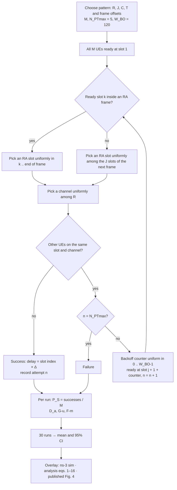
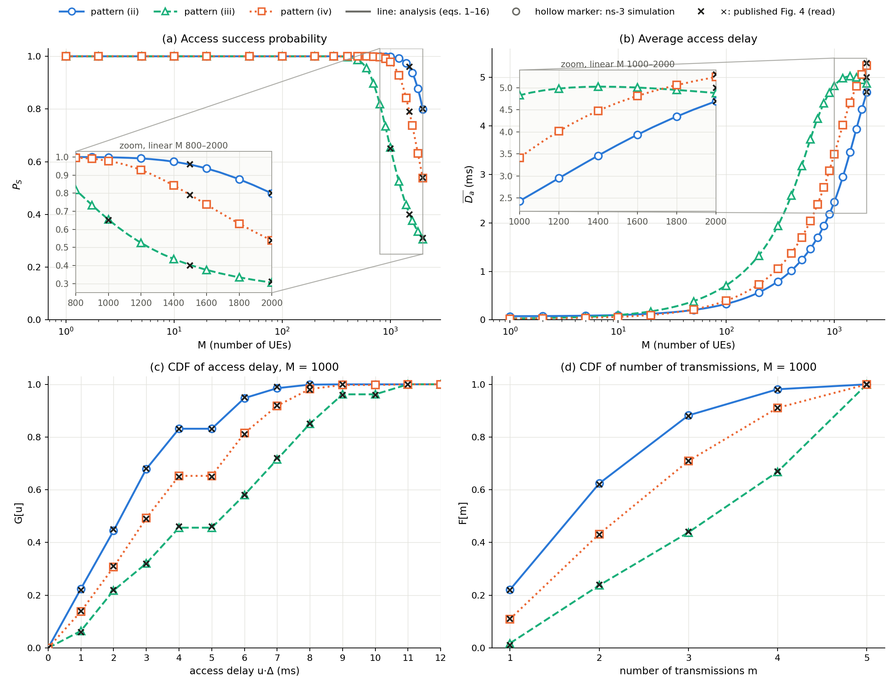

# A4 Baseline Reproduction

**Student:** M11502215 / Lucy
**Due:** 2026-11-24 23:59 · **Presentation:** 2026-12-01 (15 min)
**Reproduced result:** Fig. 4(a)–(d) (Scenario I) of the baseline paper

> Status: complete. 1,890 ns-3 runs (3 patterns × 21 M × 30 runs, ≈10^5 samples per point) match the analysis within |ΔP_S| ≤ 0.0002 and match every value read from the published Fig. 4.

## 1. Baseline Paper

T.-A. Lin and R.-G. Cheng, "Analytical Modeling and Performance Evaluation of Beam-Based Random Access Protocol for 5G Beamforming Networks," *IEEE Internet of Things Journal*, vol. 10, no. 24, pp. 22246–22255, Dec. 2023, doi: [10.1109/JIOT.2023.3305547](https://doi.org/10.1109/JIOT.2023.3305547).

**Problem.** In NR, `prach-ConfigurationIndex` and `msg1-FDM` define which RA occasions (ROs) each beam (SSB) gets. The paper asks how this *beam mapping pattern* affects random access when a burst of IoT devices accesses at once.

**Model.** A specific beam is modelled as a multiframe multichannel slotted-ALOHA system (paper Fig. 2):

- time-slots of length Δ (one RO time unit);
- RA frames of J consecutive RA slots, with R channels per RA slot (R = N^RA·N^F preamble/RO combinations);
- C frames per RO repetition period T.

The analysis applies iterative contending-user estimation to compute the mean number of contending, successful and collided UEs per slot and per attempt (eqs. 2–12). The metrics follow 3GPP TR 37.868 (eqs. 13–16).

**Why this figure.** Fig. 4 is the paper's validation result. Patterns (ii)–(iv) have the *same* number of ROs per beam (R·J·C/T = 11.2 per slot), so differences between their curves come only from how the ROs are arranged in time. My final project changes how resources are arranged, so this figure is the right baseline.

## 2. Flowchart



The analysis path (`scripts/lin_cheng_analysis.py`) uses the same slot-selection rule. It propagates *expected* numbers of UEs instead of sampling individual UEs, and it uses the success probability e^(−M_i/R) from eq. (5).

## 3. Simulation Setup

### 3.1 Parameters (paper Table I, N^RA = 56)

| Parameter | (ii) | (iii) | (iv) | Source |
| --- | ---: | ---: | ---: | --- |
| Δ (time-slot) | 0.125/6 ms | 0.125/6 ms | 0.125/6 ms | Table I |
| R (channels per RA slot) | 112 | 224 | 448 | Table I |
| J (RA slots per frame) | 6 | 1 | 1 | Table I |
| C (frames per period) | 1 | 3 | 3 | Table I |
| T1 / T2 | 60 / – | 2 / 56 | 58 / 4 | Table I |
| T (RO repetition period) | 60 | 60 | 120 | Table I |
| RA slots (first period) | 1–6 | 1, 3, 5 | 1, 5, 63 | Figs. 5(b)–(d) |
| I_max (eq. 1) | 726 slots | 705 slots | 713 slots | derived |

| Common setting | Value |
| --- | --- |
| Arrival | One-shot: M UEs ready at slot 1 (group paging) |
| M | 1, 2, 5, 10, 20, 50, 100–1000 (step 100), 1200–2000 (step 200) |
| N_PTmax / W_BO | 5 / 120 time-slots |
| Channel | Error-free; a collision occurs only when two UEs pick the same slot and channel |
| CDFs (Fig. 4c, d) | M = 1000 |

### 3.2 Seeds and runs

| Item | Paper | This reproduction |
| --- | --- | --- |
| Samples per point | 10^5 | 30 runs × 3334 samples = 1.0×10^5 |
| Simulator build | own platform | ns-3.43, `optimized` profile, g++ 11.4.0 (Ubuntu 22.04, VMware VM, 8 vCPU) |
| Run time | – | Full matrix in 9 min 49 s wall-clock (3 patterns in parallel) |
| RNG | not stated | ns-3 MRG32k3a, `RngSeed = 20261124`, `RngRun = 1..30` |
| RNG streams | – | stream 0: slot choice, 1: channel choice, 2: backoff counter |
| Statistic | average | mean of the 30 run-level values ± 1.96·s/√30 |
| Observation interval | I_max (eq. 1) | Each sample runs until no UE is pending. A self-test checks that no success occurs after I_max |

### 3.3 Implementation

| File | Role |
| --- | --- |
| [`src/beam-ra-sim.cc`](src/beam-ra-sim.cc) | ns-3 (core module) simulator. Femtosecond time resolution; each RA slot that carries transmissions is a `Simulator::Schedule` event at (slot−1)·Δ. `--selfTest=true` runs 9 checks. |
| [`scripts/lin_cheng_analysis.py`](scripts/lin_cheng_analysis.py) | Re-implementation of the analytical model, eqs. (1)–(16) |
| [`scripts/run_baseline.py`](scripts/run_baseline.py) | Runs the full 3 × 21 × 30 matrix (1,890 ns-3 runs) |
| [`scripts/plot_baseline.py`](scripts/plot_baseline.py) | Draws the four-panel overlay figure and the two slide-size figures (a)(b) and (c)(d) |
| [`scripts/plot_overlay.py`](scripts/plot_overlay.py) | For each published panel, draws my reproduction as a complete plot (frame, ticks, labels, legend) on a transparent canvas of the same pixel size. Its axes box and axis limits are calibrated to the pixel from the paper's frame and grid lines, error < 1 px. When the layer is stacked on the paper crop, both frames and all ticks coincide. Needs the paper PDF in `ref/`, which is not committed. |
| [`tests/check_baseline.py`](tests/check_baseline.py) | Checks conservation and matrix completeness, and compares simulation with analysis |
| [`results/baseline/paper_fig4_readings.csv`](results/baseline/paper_fig4_readings.csv) | Values read from the published Fig. 4 |

### 3.4 Interpretation choices (where the paper text is ambiguous)

1. **Definition of P_S.** Eq. (13) as printed divides by Σ_i M_i, which counts *all transmissions*. With that denominator, (ii) at M = 1000 gives 0.435, but the published Fig. 4(a) shows ≈ 1.0. Dividing by M (the TR 37.868 definition) gives 0.998 and matches. I use successes / M and report the per-transmission ratio as `ps_per_tx`.
2. **First attempt.** The text sets M_1[1] = M (everyone transmits in slot 1). For pattern (ii) (J = 6) this would make F[1] ≈ e^(−1000/112) ≈ 0, but the published Fig. 4(d) shows F[1] ≈ 0.22. If UEs instead spread uniformly over the J = 6 slots of the first frame (the selection rule of eq. 11), F[1] = e^(−1000/672) = 0.22. I use that rule. For J = 1 the two readings are identical.
3. **Pattern (iv) start.** The paper derives eqs. (8)–(9) for a multiframe that starts with interval T1 and says pattern (iv) starts with T2. Fig. 5(d) shows RA slots 1, 5, 63, 121, so I set the frame offsets explicitly to {0, 4, 62} within T = 120.
4. **I_max for C = 1.** T2 is undefined when C = 1, so eq. (1) uses T1 for both terms.

## 4. Numerical Results



Lines: analysis (eqs. 1–16, my implementation). Black ×: values read from the published Fig. 4. Hollow symbols: ns-3 simulation, mean of 30 runs (95% CIs are smaller than the markers). The insets in (a) and (b) zoom into M = 800–2000 on a linear axis. As in the paper, the CDFs are evaluated at u = 0, 1, …, 12 ms and m = 1…5 and joined by straight lines.

### 4.1 Analysis compared with the published figure

| Point | Published (read) | My analysis | Difference |
| --- | ---: | ---: | ---: |
| P_S (ii), M = 2000 | 0.80 | 0.799 | <0.01 |
| P_S (iii), M = 1000 | 0.65 | 0.655 | <0.01 |
| P_S (iii), M = 2000 | 0.31 | 0.306 | <0.01 |
| P_S (iv), M = 2000 | 0.54 | 0.538 | <0.01 |
| D_a (ii), M = 2000 | 4.7 ms | 4.69 ms | <0.1 ms |
| D_a (iv), M = 2000 | 5.3 ms | 5.24 ms | <0.1 ms |
| F[1] (ii) / (iii) / (iv), M = 1000 | 0.22 / 0.01 / 0.11 | 0.221 / 0.018 / 0.110 | <0.01 |
| G[1 ms] (ii) / (iii) / (iv), M = 1000 | 0.22 / 0.06 / 0.14 | 0.224 / 0.064 / 0.138 | <0.01 |

Every value read from the figure agrees with my analysis within reading accuracy (about ±0.02 for probabilities and ±0.2 ms for delay). This also reproduces the paper's qualitative findings:

- (ii) is best, (iii) is worst, and (ii) and (iv) are close for M < 1000.
- At M = 1000, the maximum access delay is about 8 ms for (ii) and (iv) and about 11 ms for (iii).
- The G[u] curve has a flat step between 4 and 5 ms: no RA slot falls in that interval after the first retransmission wave.

### 4.2 ns-3 simulation compared with analysis

From `results/baseline/raw/fig4_summary.csv` (30 runs × 3334 samples, 95% CI = 1.96·s/√30):

| Pattern | M | P_S sim ± CI | P_S anal. | D_a sim ± CI (ms) | D_a anal. (ms) |
| --- | ---: | ---: | ---: | ---: | ---: |
| (ii) | 1000 | 0.99819 ± 0.00001 | 0.9982 | 2.4335 ± 0.0004 | 2.4345 |
| (ii) | 2000 | 0.79872 ± 0.00009 | 0.7987 | 4.6941 ± 0.0003 | 4.6940 |
| (iii) | 1000 | 0.65437 ± 0.00012 | 0.6545 | 4.8313 ± 0.0006 | 4.8302 |
| (iii) | 2000 | 0.30588 ± 0.00007 | 0.3059 | 4.8807 ± 0.0006 | 4.8809 |
| (iv) | 1000 | 0.97840 ± 0.00004 | 0.9785 | 3.4154 ± 0.0006 | 3.4167 |
| (iv) | 2000 | 0.53837 ± 0.00008 | 0.5384 | 5.2443 ± 0.0005 | 5.2442 |

CDF of the number of transmissions at M = 1000, F[1..5]:

| Pattern | ns-3 | Analysis |
| --- | --- | --- |
| (ii) | 0.221, 0.624, 0.882, 0.981, 1 | 0.221, 0.624, 0.882, 0.981, 1 |
| (iii) | 0.018, 0.237, 0.438, 0.668, 1 | 0.018, 0.237, 0.438, 0.668, 1 |
| (iv) | 0.110, 0.432, 0.710, 0.911, 1 | 0.110, 0.432, 0.709, 0.911, 1 |

`tests/check_baseline.py` result: 1,890 runs, 63 points, no conservation error. Over all 63 points, max |ΔP_S| = 0.0002 and the largest D_a difference for M ≥ 20 is below 0.2%. The only points flagged are D_a for (iii) and (iv) at M ≤ 10, where the analysis is higher by 0.004–0.008 ms (explained in §5).

## 5. Explaining the Differences

| Source | Effect | Expected size |
| --- | --- | --- |
| **Reading the published figure by eye** | The "published" points are my visual readings, not the authors' data | ±0.02 (probability), ±0.2 ms (delay) |
| **Poisson approximation in the analysis** | Eq. (5) uses e^(−M_i/R) with the *mean* M_i. The simulation uses the exact finite-UE collision rule with a random M_i. | Measured: |ΔP_S| ≤ 0.0002 everywhere, because R ≥ 112 makes the Poisson limit very accurate. The one visible effect is at very small M: for M = 1 the analysis still assigns collision probability 1 − e^(−1/R) > 0 (0.45% for (iii)), so those UEs back off. The simulation correctly gives zero collisions and D_a = 1·Δ = 0.0208 ms. Size: ≤ 0.008 ms, invisible in Fig. 4(b) |
| **Number of samples** | 10^5 per point, the same as the paper | CI half-widths ≤ 0.00012 (P_S) and ≤ 0.0011 ms (D_a), well below plot resolution |
| **Text ambiguities** (§3.4) | Eq. (13) denominator, M_1[1], pattern (iv) start | Resolved by matching the published curves; with the literal readings, items 1 and 2 would *not* match |
| **Unmodelled effects** (same in the paper) | Preamble detection probability, RAR window and processing delay, Msg3/4 contention resolution, multiple beams | None vs. the paper; this is a limitation of the baseline |
| **Different simulator** | The paper used its own TR 37.868 RACH platform; I used ns-3 core with a custom event model | Expected to be none if both implement the same rules |

## 6. Reproduction

**1. Build (Linux, ns-3.43)**

```bash
cd ~/ns-allinone-3.43/ns-3.43
cp <repo>/A4-baseline/src/beam-ra-sim.cc scratch/
./ns3 configure -d optimized && ./ns3 build
EXE=$PWD/build/scratch/ns3.43-beam-ra-sim-optimized
$EXE --selfTest=true          # 9 PASS lines
```

**2. Run the matrix** (3 patterns in parallel, about 10–15 min):

```bash
mkdir -p ~/a4-results
for P in ii iii iv; do
 ( for M in 1 2 5 10 20 50 100 200 300 400 500 600 700 800 900 1000 1200 1400 1600 1800 2000; do
    for R in $(seq 1 30); do
     H=""; [ $M -eq 1000 ] && H="--histFile=$HOME/a4-results/fig4_hist_$P.csv"
     $EXE --pattern=$P --ueCount=$M --nptMax=5 --wbo=120 --samples=3334 \
          --seed=20261124 --run=$R --outputFile=$HOME/a4-results/fig4_runs_$P.csv $H
    done; done ) &
done; wait
```

`python3 A4-baseline/scripts/run_baseline.py --exe $EXE` does the same with a thread pool.

**3. Collect, check and plot.** Copy the six CSVs into `A4-baseline/results/baseline/raw/`, then run:

```bash
python A4-baseline/scripts/run_baseline.py --collect   # -> fig4_runs.csv, fig4_hist_M1000.csv, fig4_summary.csv
python A4-baseline/tests/check_baseline.py
python A4-baseline/scripts/plot_baseline.py            # -> results/baseline/figures/fig4_reproduction.png
```

Example single point: `$EXE --pattern=iii --ueCount=1000 --nptMax=5 --wbo=120 --samples=3334 --seed=20261124 --run=1`.

## 7. Relation to the Final Project

This baseline gives a validated pair (simulation + analysis) for one beam with one-shot arrivals. The final project can change one factor at a time against this curve:

- RO layout or W_BO choice (paper Fig. 6 shows the non-monotone effect of W_BO for (iii));
- a non-one-shot arrival process;
- an added NTN round-trip delay, which links back to the A3 proposal.

> Note: the other material in this folder (`A3-massive-ue-report.md`, `results/massive/`, `results/raw/`, `scripts/run_*experiments.py`) is the A3 extension with assumed parameters and is **not** part of this reproduction.
